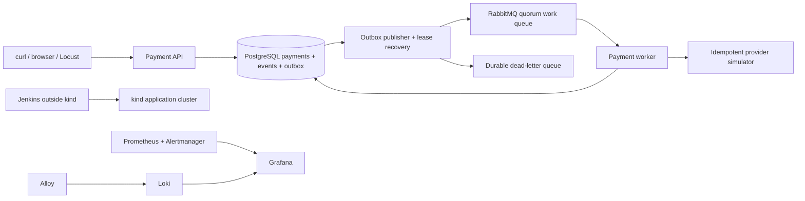

# PayOps

A local payment reliability and DevOps lab. It processes **synthetic payments only**, using FastAPI, PostgreSQL, a transactional outbox, RabbitMQ, a worker, and an idempotent provider simulator. Docker Compose supports development; kind supports Kubernetes operations. Jenkins builds and validates releases outside the application cluster. Prometheus, Grafana, Alertmanager, Loki, and Alloy provide local observability.

No AWS account, banking API, Docker account, paid service, or real payment data is required.

## Start with Docker Compose

Requires Python 3.11+, Git if you want version control, and a running Linux Docker engine with Compose v2. On Windows use Docker Engine in Ubuntu WSL2, or an existing Docker Desktop installation. Run all commands in the same environment as your Docker engine. Allow several GB for first-run public images. Use Compose alone on an 8 GB machine; run Jenkins and kind selectively.

Windows PowerShell:

```powershell
python -m venv .venv
.\.venv\Scripts\python.exe -m pip install -r requirements.lock
.\.venv\Scripts\python.exe -m pip install -e '.[dev]'
.\.venv\Scripts\python.exe ops.py init
.\.venv\Scripts\python.exe ops.py doctor
.\.venv\Scripts\python.exe ops.py up --monitoring --logging
.\.venv\Scripts\python.exe ops.py smoke
```

Linux/Ubuntu WSL2:

```bash
python3 -m venv .venv
. .venv/bin/activate
pip install -r requirements.lock
pip install -e '.[dev]'
make init
make doctor
make up ARGS='--monitoring --logging'
make demo
```

Omit `--monitoring --logging` for the smaller core stack. Docker Compose creates the schema before starting application processes. Each process reconnects after dependency outages.

| Interface | Local URL | Login |
|---|---|---|
| Payment console | [Open PayOps](http://127.0.0.1:8000/) | None; loopback development app |
| Interactive payment API | [Swagger UI](http://127.0.0.1:8000/docs) | None; loopback development API |
| Grafana dashboard | [PayOps dashboard](http://127.0.0.1:3000/d/payops) | `admin`, `GRAFANA_PASSWORD` from `.env` |
| RabbitMQ | [Queue management](http://127.0.0.1:15672) | `payops`, `RABBITMQ_PASSWORD` from `.env` |
| Prometheus | [Metrics and targets](http://127.0.0.1:9090) | Local only |
| Alertmanager | [Active alerts](http://127.0.0.1:9093) | Local only |
| Jenkins (optional) | [Local CI/CD](http://127.0.0.1:8080) | `admin`, `JENKINS_PASSWORD` from `.env` |

`init` generates random hex credentials in ignored `.env`, preserving existing values. Open the file locally to retrieve logins; do not paste it into logs or commit it. API, queue management, dashboards, and CI ports bind to `127.0.0.1`. PostgreSQL, AMQP, Loki, and service metrics are internal to Docker. There is no application authentication because this is a loopback-only lab; do not expose it publicly. Docker/Alloy/Jenkins socket access is powerful host access for your own trusted code.

## Submit a payment

Open the [payment console](http://127.0.0.1:8000/) and choose **New payment**. Enter an amount in major units (for example `125.00`), select a currency and provider test case, then submit. Select a payment ID to follow attempts, the provider reference, errors, and ordered events. The ledger and open details refresh every three seconds; search and status filters apply to the latest 100 payments. Times are shown in your browser's timezone.

Under **Request options**, an idempotency key is generated for each new payment. Reusing a key with identical input returns the original payment; changed input shows a conflict. Interrupted submissions preserve their input and key so they can be retried safely. Grafana and Alertmanager links require the monitoring profile.

The frontend is ordinary HTML, CSS, and JavaScript served by FastAPI from `payops/static`; no separate frontend server or build step is required. Its font is bundled locally under the included OFL license. Run `node --test tests/frontend.test.mjs` for the optional JavaScript helper checks, alongside `python ops.py test` and `python ops.py lint`.

```bash
curl -s http://127.0.0.1:8000/payments \
  -H 'Content-Type: application/json' \
  -H 'Idempotency-Key: demo-001' \
  -d '{"amount_minor":12500,"currency":"INR","scenario":"success"}'
```

PowerShell alternative:

```powershell
$body = @{amount_minor=12500; currency='INR'; scenario='success'} | ConvertTo-Json
Invoke-RestMethod http://127.0.0.1:8000/payments -Method Post -ContentType application/json -Headers @{'Idempotency-Key'='demo-001'} -Body $body
```

New requests return `202`; an identical replay returns `200` with the same payment ID. Reusing the key with different input returns `409`. Get `/payments/{id}` for state and `/payments/{id}/events` for ordered history. `/payments` lists the latest 100 payments. `/healthz` checks process liveness; `/readyz` checks database/schema access. OpenAPI describes all fields.

Amounts are positive integer minor units, up to 100,000,000. `12500 INR` means ₹125.00. Supported test currencies are INR, USD, EUR; no currency conversion or live exchange-rate calls occur. Never supply card or bank information. Unknown fields are rejected. All timestamps are UTC.

| Scenario | Expected result | Attempts |
|---|---|---|
| `success` | succeeded | 1 |
| `decline` | rejected business decision | 1 |
| `flaky` | temporary outage, then succeeded | 2 |
| `timeout` | failed, durable dead letter | 3 |
| `timeout_after_success` | provider commits success, response times out; retry returns same reference | 2 |

The smoke command verifies every row, API replay/conflict behavior, terminal states, and attempt counts. It saves `.local/smoke-results.json`.

## Kubernetes with kind

Install `kubectl` on your host if absent. `install-tools` downloads kind v0.30.0 into ignored `.local/bin` and verifies its release checksum. No global PATH changes are needed.

```bash
python ops.py install-tools
python ops.py bootstrap
python ops.py build --tag release-001
python ops.py deploy --tag release-001 --monitoring --logging
python ops.py forward --service api
```

Use `.venv\Scripts\python.exe` for these commands in PowerShell. `make bootstrap`, `make build ARGS='--tag release-001'`, and `make deploy ARGS='--tag release-001 --monitoring --logging'` are equivalent on Linux.

`bootstrap` creates a single-node `payops` cluster and writes a dedicated `.local/kubeconfig`; all deployment commands explicitly select `kind-payops`. `deploy` loads the tagged image, creates generated Secrets, applies resources, waits for database/broker readiness, runs the additive v1 schema job, waits for application rollouts, and smoke tests through a temporary port-forward. A successful release is saved in the cluster's `payops-release` ConfigMap, with convenience copies in `.local`. Validated tags cannot be reused; build a new tag for every release. Failed later deployments restore the previous validated manifest and wait for its rollouts. A failed first deployment has no release to restore; its candidate application deployments are removed while database volumes are preserved.

Open other interfaces in separate terminals with `python ops.py forward --service grafana` (or `prometheus`, `alertmanager`, `rabbitmq`). Stop Compose first with `python ops.py down` if you want to reuse its host ports. The deploy smoke test uses port 18000 to avoid this collision.

Kubernetes objects are generated by `infra/manifests.py` as native Kubernetes JSON, which the API accepts like YAML. Inspect them with `python ops.py render --tag release-001 --monitoring --logging`. Application images use `imagePullPolicy: Never`. Database, RabbitMQ, Grafana, metrics, and Loki use PVCs. No external registry or ingress is required. Omitted observability flags do not delete previously installed resources.

```bash
kubectl --kubeconfig .local/kubeconfig --context kind-payops -n payops get pods,pvc
kubectl --kubeconfig .local/kubeconfig --context kind-payops -n payops logs deployment/worker
python ops.py rollback
```

## Local Jenkins

Create the kind cluster first; Jenkins joins its Docker network while running outside Kubernetes. Stop the Compose application to save RAM when using the full kind stack.

```bash
python ops.py jenkins
```

The image installs Python, Docker CLI, kind, kubectl, and pipeline plugins. Startup creates the local `admin` account and a `PayOps` pipeline job from `Jenkinsfile`. Sign in using `JENKINS_PASSWORD` in `.env`, then select **Build with Parameters**. A blank `GIT_REPOSITORY` snapshots the mounted local source, excluding credentials, virtualenv, and local state. Set a Git URL to check out its `main` branch instead. No repository host or webhook is required for local snapshots.

The plugin set is pinned in `infra/jenkins/plugins.lock.json`, including official SHA-256 checksums. Downloads use a verified build cache and bounded retries. Restart the Jenkins container after changing the local `Jenkinsfile` to reload its job definition; application source changes are picked up on each build.

The pipeline installs dependencies, runs lint/tests, builds an immutable `build-N` image, loads it into kind, deploys, smoke tests, archives results, and restores the previous validated release on failure. Validated release snapshots live in the cluster, shared with manual deployments and other workspaces. The dedicated kubeconfig uses the cluster's internal network address. Back up Jenkins home if you need its build logs after deleting its volume. Cluster deletion removes release snapshots.

Run one healthy build before selecting `BROKEN_RELEASE`. This builds an image whose API import deliberately fails while the migration still works. The failed rollout triggers restoration, and the Jenkins build stays red. An explicit `python ops.py rollback` also smoke tests the previous version. Application restoration does not reverse database migrations; v1 uses additive schema creation only. Later schema changes require versioned migration scripts and backward compatibility.

## Monitoring and failure exercises

The provisioned Grafana dashboard displays API rate/errors/latency, payment completion, durable payment states, queue backlog/dead letters, retry results, process health, process CPU/memory, and structured logs. Kubernetes adds container CPU/memory from authenticated cAdvisor scraping. Use `docker stats` for full Compose container resource measurements. Empty graphs need traffic; cumulative process counters reset on restart while payment-state gauges come from PostgreSQL.

Alertmanager receives process-down, stale-heartbeat, queue/outbox-backlog, dead-letter, and API-error alerts. Alerts stay in the local UI with no outbound email or messaging integration. A deliberate timeout smoke test leaves a dead letter, so its alert is expected.

```bash
python experiments.py --target compose --pause 55
docker compose exec -T api python -m payops.exercises queues
docker compose exec -T api python -m payops.exercises poison
python ops.py logs
```

The experiment stops the worker, submits a payment, verifies it stays pending during the outage, restarts the worker in a `finally` block, verifies recovery, publishes five duplicate messages, and verifies the provider reference and attempt count do not change. Evidence is saved in `.local/experiment-results.json`. Run against kind with `--target kind` while an API port-forward is running. After 30–55 seconds, inspect the worker/backlog alerts in Alertmanager. Poison messages go through RabbitMQ's dead-letter exchange to the durable dead queue.

See [the runbook](docs/runbook.md) for crashes, dependency outages, and incident-report templates. Actual reports are included for the [worker outage](docs/incidents/worker-outage.md) and [failed Kubernetes release](docs/incidents/failed-release.md).

## Tests and load

```bash
python ops.py lint
python ops.py test
python ops.py smoke
locust -f load/locustfile.py --host http://127.0.0.1:8000 --headless -u 10 -r 2 -t 30s --csv .local/load
```

Unit tests use real SQLAlchemy transactions against SQLite. Separate PostgreSQL tests cover concurrent unique-key insertion, row-lock claiming, and payment/outbox atomicity. They require a **dedicated** test database and `PAYOPS_TEST_DATABASE_URL`; otherwise they explicitly skip. They never drop an existing database. Example while the core stack runs:

```bash
docker compose exec -T postgres createdb -U payops payops_test
docker compose exec -T postgres psql -U payops -d payops_test -c 'SELECT 1'
```

Run `python ops.py integration` to execute both PostgreSQL tests automatically. It temporarily exposes PostgreSQL on loopback port 15432, creates `payops_test` if needed, passes its URL only through the child environment, and removes the port mapping afterward. Run this separately from smoke/load tests because changing the port mapping restarts the database container. See [verification](docs/verification.md) for checks actually performed here. Load measurements depend on hardware; no invented throughput claims are included.

## Backup, shutdown, and persistence

```bash
python ops.py backup
python ops.py restore --file .local/backups/payops.dump --confirm
python ops.py down
python ops.py teardown --confirm
```

Backup/restore commands target **Compose PostgreSQL**. Restore stops API/worker/publisher/simulator, restores the dump in a single transaction, and starts them again. After restore, a maintenance transaction fences old leases and creates fresh outbox work for every nonterminal payment, including payments whose earlier queue messages were already consumed. Duplicate broker messages remain safe. For kind, use the equivalent `kubectl exec postgres-0 -- pg_dump ...` and stop application deployments during restore. Keep backups outside `.local` and on another device to survive computer loss.

`down` preserves Compose named volumes. Pod/container restarts preserve their volumes. `teardown --confirm` deletes the kind cluster and its volumes. Removing Docker named volumes also destroys their data. This lab demonstrates process/release recovery on one computer; it has no independent-machine or availability-zone redundancy.

## Optional Terraform practice

`infra/terraform` manages only the separate `payops-practice` namespace and its resource quota. Application manifests and Terraform never own the same objects.

```bash
terraform -chdir=infra/terraform init
terraform -chdir=infra/terraform plan -var='kubeconfig_path=/absolute/path/to/payops/.local/kubeconfig'
terraform -chdir=infra/terraform apply -var='kubeconfig_path=/absolute/path/to/payops/.local/kubeconfig'
```

Keep state private. Destroy these practice resources before deleting the cluster. This is local Kubernetes provisioning, with no AWS provisioning claim.

## Architecture and code



See [architecture and delivery guarantees](docs/architecture.md), [operations runbook](docs/runbook.md), and [verification evidence](docs/verification.md). The implementation is intentionally a single package with separate process entry points, allowing the same image and tests to run across Compose, kind, and CI.
