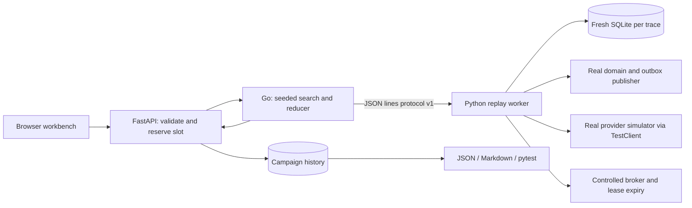

# Failure discovery architecture

## Why this exists

A readiness probe cannot establish that a payment's retry, acknowledgement and
provider-idempotency behavior is correct. Keel searches controlled executions for
counterexamples to specific business and recovery invariants. Its deliberately faulty
adapters provide positive controls: the lab must show that it can detect known defects.

## Execution path

The same routes run in the ordinary application or the standalone server. Application
PostgreSQL is only used to save reports, never as an experiment target. Standalone
history uses a distinct SQLite file. Every trace disposes its private database engine.

## What actually runs

`create_payment`, `claim_payment`, `complete_payment`, `recover_expired`, and
`publish_batch` are the application's existing functions. The real simulator handles
HTTP calls through an in-process ASGI test client and persists provider decisions.
The harness splits worker processing into delivery, provider response, result commit
and acknowledgement so a controlled crash can occur at their boundaries. It does not
execute the worker's actual AMQP polling loop, replace the worker process, or generate
operating-system crashes. Retry delays are zero and lease expiry is applied explicitly.

Adapters model four mistakes: remove the initial outbox row; acknowledge a claimed
delivery prematurely; use a fresh provider payment ID per attempt; impersonate an old
lease before submitting an expired worker result. These are explicit behavioral
mutations, not source-code rewriting or production feature flags. The normal application
contains no mutation switches. One logical payment is investigated per trace.

The oracle reads durable payment/outbox/provider state, broker adapter state and actual
stale-completion acceptance. It checks: waiting work retains intent; acknowledgement
does not precede commit; successful provider effects do not exceed one; expired worker
results do not overwrite a newer claim. These checks are independent of adapter names.

## Discovery and reduction

The Go controller mixes normal processing, crash recovery, response-loss recovery and
seeded random schedules. It stops at the first relevant violation for each selected
fault. It runs the original schedule against the correct implementation before counting
a fault as detected. Then it repeatedly tries deleting one event. An accepted deletion
must reproduce the same invariant; scanning restarts after each successful deletion.
The final scan establishes single-deletion minimality. The reduced sequence is also
replayed against the correct implementation. A baseline violation invalidates the campaign.

Search budget bounds discovery schedules per selected fault; reduction evaluations are
reported separately. The controller caps total evaluations at 2500 and its worker
lifetime at 75 seconds. The API caps process duration at 85 seconds and output at 2 MB.
There is one campaign/replay slot per API process; overlapping work returns HTTP 429.
Requests allow seeds 0..2147483647, 1..32 search schedules, 1..4 distinct known faults
and at most 32 known events per trace. Child processes use argument arrays, not a shell.
Worker errors are errors, never surviving mutants. Runs are saved only after completion.

A seed reproduces generated action ordering; payment IDs, timestamps and provider
references are deliberately fresh, so complete JSON reports are not byte-identical.
Unmet action preconditions are recorded as no-ops and can be removed by reduction.
Execution stops at the first invariant violation; unexecuted original suffixes are
retained in the original schedule and explained in the UI.

## API and artifacts

- `GET /lab`: workbench.
- `GET /api/lab/catalog`: faults, invariants, actions and controller availability.
- `POST /api/lab/campaigns`: discover and save a campaign.
- `GET /api/lab/campaigns`: latest 30 saved campaigns.
- `GET /api/lab/campaigns/{id}`: full saved evidence.
- `GET /api/lab/campaigns/{id}/artifacts/{json|markdown|pytest}`: export.
- `POST /api/lab/replay`: execute a bounded schedule in a fresh database.

Generated tests execute the reduced schedule against the correct implementation by
default. `KEEL_MUTATION=<fault>` selects a lab adapter to demonstrate that the test
rejects it. No counterexample means no regression is fabricated. CLI `--require-all`
returns failure if the selected known faults are not all detected, for CI use.

## Interpretation and limits

This is reproducible failure exploration, not proof of correctness, historical incident
replay, PostgreSQL concurrency testing or a distributed chaos platform. The fault catalog
and invariants are finite. Single-deletion minimality is weaker than global shortestness.
Survival is inconclusive. Existing real PostgreSQL, Compose and kind tests remain useful
and cover boundaries this feature deliberately controls. Keep the application's existing
loopback-only access policy; this workbench is not an authenticated public service.

## Interview demonstration

Run seed 42, budget 8, all four faults. Select changing provider identity. Show the
provider decision before the worker crash, the recovered attempt, and two stored
provider successes. Switch to the correct implementation: the same sequence preserves
one provider success. Replay the reduced failure, download its pytest test, run it
successfully on the baseline, then demonstrate its expected failure with the faulty
adapter selected. The evidence explains both why the defect matters and why the test
would catch it again.

See [executed checks and boundaries](failure-discovery-verification.md) for measured
results, including the constrained offline Linux container run.
